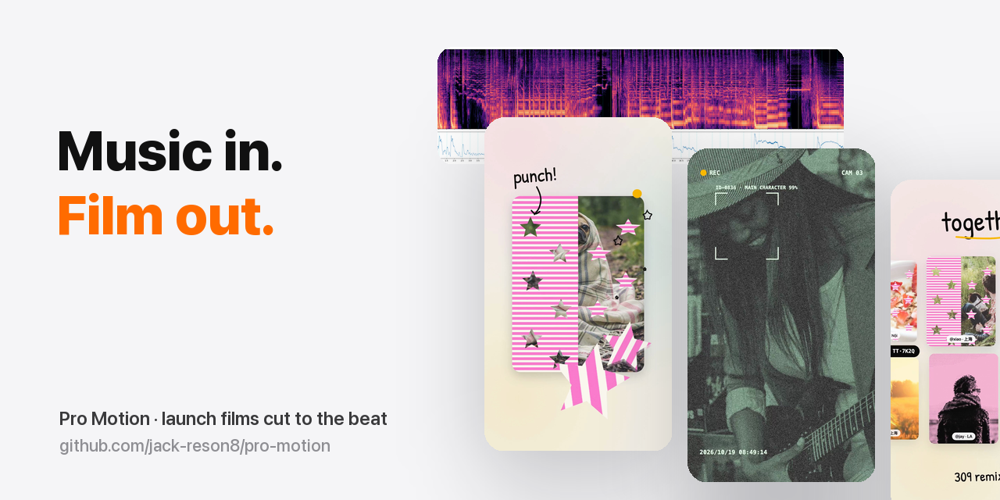

# Pro Motion · Claude Code で作る、音から始めるモーショングラフィックス映像

[English](README.md) | [简体中文](README.zh-CN.md) | 日本語 | [한국어](README.ko.md) | [Tiếng Việt](README.vi.md) | [हिन्दी](README.hi.md)

<p align="center"></p>
<p align="center"><sub><a href="https://github.com/jack-reson8/copy-that"><b>Copy That</b></a> シリーズの一つ · 1 行で全部インストール</sub></p>
<p align="center"><a href="https://jack-reson8.github.io/skill-skill/check/"></a></p>

**プロダクトを渡してください(曲も一緒に、あるいは曲の企画から任せることも可能)。テンプレートではなく「設計された」ローンチ映像・ブランド映像・TVC が、コードでレンダリングされ、ビートに合わせてカットされ、数分で手に入ります。**

<table><tr>
<td align="center"><br><sub><b>ローンチ映像</b> · プロダクト UI、演じるエフェクト、5 言語版</sub></td>
<td align="center"><br><sub><b>ブランド映像</b> · スタイライズされたアニメーション、モノが楽器になる</sub></td>
<td align="center"><br><sub><b>スターターテンプレート</b> · インストール時に入る 8 秒のデモ</sub></td>
</tr></table>

<sub>このスキルで、写真で遊ぶアプリ <b>Tutti</b> のために制作した映像です。フルレングス版は <a href="https://github.com/jack-reson8/pro-motion/releases">最新リリース</a>に添付しています。</sub>

いまの「AI 動画」の多くは、テンプレート(3D のスマホ + App Store バッジ)か、演出をコントロールできない生成クリップのどちらかです。Pro Motion は第三の道をとります。**まず音楽をマーケティング資産として設計し、そのうえで Claude が映像をコードとして書く**。キャンバス上の決定論的な `render(t)` です。だからすべてのヒットが 16 分音符単位で音に乗り、すべてのトランジションが設計され、どのショットもタイムスタンプ指定で修正して数秒で再レンダリングできます。

これは、実際のプロジェクトで約 10 回繰り返された「PowerPoint みたい」「素材がダサい」「文字が映像の上に浮いている」「スタイライズって言ったのにポップアートになってる」というダメ出しを経て、ようやくカットが承認されるまでに磨かれた手法を抽出したものです。**結果を分けたのは手法そのものなので、このスキルが収めているのも手法です。**

## できること

| ステップ | Claude がやること |
|---|---|
| 1 · ブリーフ | プロダクト、ターゲット、市場、音楽、アスペクト比、映像の種類を決める。質問攻めにせず、デフォルトを自分で決める |
| 1b · キャンペーン + 音 | `campaign.md` ワークシート:12 の非常識マーケティング手法(媒体が故障する、隣の広告看板との会話、制約をネタにする、不条理なマスコット、一人ひとりへの大量返信、UGC 軍団、FOOH…)から 6 つの企画案を出し、採点して 1 つ選ぶ。続いてキャンペーンの核(真実・緊張・仕掛け・チャネル)、サウンドロゴとフックを含む音の設計、精密な Suno/Udio 用プロンプトを 1 本作り、最後に `audio_post.py` でビッタリ合う SFX、スタッター、ループ、ラウドネスを仕上げる |
| 2 · 音楽 | `analyze_music.py` → テンポ、ビートグリッド、オンセット、低域/高域のヒット、グリッドを重ねたスペクトログラム。スペクトログラムがそのまま編集表になる |
| 3 · リサーチ | 公式アップロードを探し、yt-dlp(ブラウザ不要)で 24 フレームの**コンタクトシート**を取得し、参考作品ごとに**テクニックシート**を書く |
| 4 · ディレクション | 名前のついたテクニックから、**はっきり違う 3 つのスタイルフレーム**を作る。アニメーションに入る前にあなたが選ぶ |
| 5 · ストーリー | 全シーンで変身し続ける**主人公**を 1 人立てる。機能はすべて音楽イベントに合わせて自分で演じる。トランジションはすべて設計する。文字はアニメーションの一部。ラストはロゴへと育つ |
| 6 · ビルド | `motion-lib.js`:イージングとスプリング、スクワッシュ&ストレッチ、オンセットで動くビートカメラ、12 fps の落書き風ライン揺れ、手書き文字、メタボール、ハーフトーン、ストライプ、3D カードリング、ステッカー縁取り、被写体の切り抜き(macOS Vision)、多言語切り替え。さらに AE / Blender / アニメ演出の決定論的な canvas 版を 40 種以上収録:curl ノイズのパーティクル、ロゴに集まるパーティクル、Saber グロー、シャイン、ウィップパン、アイリス、インクにじみ、シャッター、ズームスルー、紙破り、モーフ、マンガのコマ割り、無限ズーム、RGB スプリット、グリッチ、ディザ、ASCII、リソ印刷、切り絵、トゥーンシェーディング、ハッチング、水彩、スリットスキャン、エコー、スピードランプ。`fx-demo.html` で各エフェクトを 1 秒ずつ確認できる |
| 7 · レンダリング | `render-fast.js`:ヘッドレスタブを並列で回して JPEG フレームを出力し、ffmpeg で一括ミックス。60 fps・20 秒の映像で約 30 秒。コンタクトシートと音声の長さをチェック |
| 8 · イテレーション | フィードバックはタイムスタンプ単位。センスに関する指摘は、つぎはぎ修正ではなくリサーチとディレクションに戻す |

<p align="center"></p>

## インストール

**Claude Code プラグインとして(推奨)**

セッション内で `/plugin install pro-motion --marketplace jack-reson8/pro-motion` を実行するか、シェルから次のようにします。

```bash
claude plugin marketplace add jack-reson8/pro-motion
claude plugin install pro-motion@pro-motion
```

**通常のスキルとして**

```bash
git clone https://github.com/jack-reson8/pro-motion
cp -R pro-motion/plugins/pro-motion/skills/pro-motion ~/.claude/skills/
```

必要環境:Node 18 以上、`numpy scipy matplotlib` を入れた Python 3、Chrome/Chromium(自動検出。`CHROME=/path` で指定も可)。被写体の切り抜きには macOS 14 以上が必要です。それ以外はすべて `scripts/setup.sh` がプロジェクトごとにインストールします。

**Codex** (CLI または ChatGPT デスクトップアプリ):

```bash
codex plugin marketplace add jack-reson8/pro-motion
codex plugin add pro-motion@pro-motion
```

または `plugins/pro-motion/skills/pro-motion` を `~/.codex/skills/` にコピーしてください。このスキルはオープンな [Agent Skills](https://agentskills.io) 標準に準拠しているため、Claude Code、Codex、SKILL.md を読めるあらゆるエージェントで動作します。

**その他のエージェント** (Cursor、Gemini CLI、GitHub Copilot など、skills CLI がサポートするエージェント):

```bash
npx skills add jack-reson8/pro-motion
```

## 使い方

曲を添えて、そのまま頼むだけです。

> 私の写真アプリの 20 秒ローンチ動画を、`~/Downloads/track.mp3` に合わせてカットして。縦型、英語がマスターで、日本語版と韓国語版も。

> 用这首歌给我的品牌做一支强烈风格化的品牌片，先给我三个风格方向的风格帧。

> 8〜10 秒のあたりがスライドショーっぽい。そこのトランジションを作り直して。

Claude はスキルに沿って進めます。音楽を解析し、コンタクトシートでリサーチし、スタイルフレームを見せ、`shotmap.md` を書き、`film.js` を組み、`out/*.mp4` をレンダリングし、フレームシートを確認して、仕上がりを開きます。

## 中身

```
plugins/pro-motion/skills/pro-motion/
├── SKILL.md                    # 手法そのもの(Claude が読む)
├── scripts/
│   ├── setup.sh                # ワンコマンドでプロジェクトをセットアップ
│   ├── analyze_music.py        # テンポ、グリッド、オンセット、スペクトログラム
│   ├── audio_post.py           # ビッタリ合う SFX、スタッター、ループ、ラウドネス
│   ├── render-fast.js          # 並列レンダリング、スチルモード、音声ミックス
│   ├── contact_sheet.sh        # 指定した秒のフレーム → 1 枚の画像
│   ├── ref_frames.sh           # 参考動画 → 24 フレームのシート(yt-dlp)
│   ├── cutout.swift            # 被写体マスク(macOS Vision)
│   └── faces.swift             # 顔の検出ボックス(macOS Vision)
├── assets/template/            # campaign.md · audio-plan.md · film.html · film.js (実行できるデモ) · motion-lib.js · fx-demo.html · OFL フォント
└── references/
    ├── unconventional-marketing.md  # 12 の非常識マーケティング手法 → 手順 → 事例 → 応用方法
    ├── campaign-cases.md       # 広がったローンチ施策の事例
    ├── audio-first.md          # キャンペーンの核、音の設計、生成ツール用プロンプト
    ├── vfx-techniques.md       # トランジション、リズム、AE / Blender / スタイライズ表現:出典 · パラメータ · ライブラリ呼び出し
    ├── sourcing.md             # 参考作品の探し方と読み方
    ├── research-notes.md       # テクニックシートの実例
    ├── aesthetic-checklist.md  # 物語 · 動き · 文字 · 質感 · 言語 · 納品
    └── lessons.md              # すでに支払い済みのバグとセンスの失敗集
```

## 原則(短縮版)

1. **音楽が編集そのもの。** スペクトログラムを読み、すべての動きをマップしたイベントに乗せる。
2. **実際のフレームを見る。記憶でデザインしない。**
3. **スタイルフレームで方向を決める。** 最初の連想や、コードにしやすいものを選ばない。
4. **1 人の主人公、演じるエフェクト、設計されたトランジション。** さもないと PowerPoint に見える。
5. **文字はアニメーション。** ローワーサード、チップ、ボックスは使わない。
6. **ダサい素材はダサい映像になる。** 本物で、現在のもので、ライセンス上安全な素材を使う。なければ余白にする。
7. **数秒でレンダリングし、コンタクトシート 1 枚で確認して、納品。** 以降はタイムスタンプ単位で反復する。

## ライセンス

コードとドキュメント:MIT(`LICENSE` を参照)。同梱フォント:SIL Open Font License 1.1(Patrick Hand、Yomogi、Gaegu、ZCOOL KuaiLe)。`assets/template/assets/fonts/LICENSES.md` を参照してください。`ref_frames.sh` でダウンロードした参考動画は個人的な学習用に限り、再配布しないでください。

コントリビュート歓迎です。特に新しいモーションのプリミティブ、トランジション、テクニックシート、学びの共有を歓迎します。`CONTRIBUTING.md` を参照してください。
