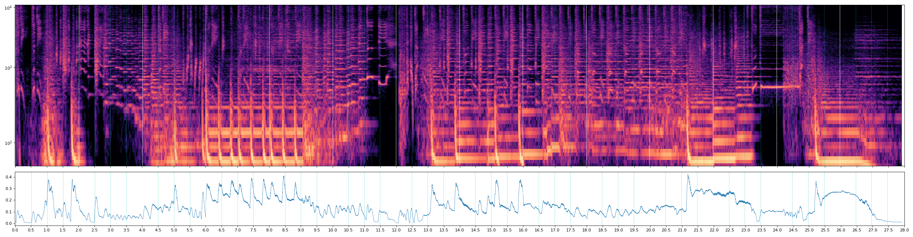

# mg-launch-video · a Claude Code skill for motion-graphics films

**Give Claude a music track and a product. Get a launch film or brand film that is designed, not templated — rendered in code, cut to the beat, in minutes.**

<p align="center"></p>

[中文说明](README.zh-CN.md)

Most "AI video" today is either a template (3D phone + App Store badge) or a generated clip you can't direct. This skill takes a third path: **Claude writes the film as code** — a deterministic `render(t)` on a canvas — so every hit lands on the music to the 16th note, every transition is designed, and any shot can be changed by timestamp and re-rendered in seconds.

It is the method distilled from a real project that went through ~10 rounds of "this looks like a PowerPoint", "the material is ugly", "the text floats on top", "I said stylized, not pop art" — until the cuts were accepted. **The method made the difference, so the method is what this skill encodes.**

## What it does

| Step | What Claude does |
|---|---|
| 1 · Brief | Fixes product, audience, markets, music, ratios, film type — decides defaults instead of interrogating |
| 2 · Music | `analyze_music.py` → tempo, beat grid, onsets, low/high hits, a spectrogram with the grid drawn on. The spectrogram is the edit |
| 3 · Research | Finds official uploads, pulls 24-frame **contact sheets** with yt-dlp (no browser), writes a **technique sheet** per reference |
| 4 · Direction | **Three clearly different style frames** from named techniques — you pick before anything is animated |
| 5 · Story | One **protagonist** that transforms through every scene; every feature performs itself on a music event; every transition designed; text is animation; the ending grows into the logo |
| 6 · Build | `motion-lib.js`: easing & springs, squash/stretch, 12-fps doodle line boil, pen-written text, metaballs, halftone, stripes, 3D card ring, sticker outlines, subject cutouts (macOS Vision), multi-language switch |
| 7 · Render | `render-fast.js`: parallel headless tabs → JPEG frames → one ffmpeg mux. ~30 s for 20 s @ 60 fps. Contact-sheet check, audio-length check |
| 8 · Iterate | Feedback by timestamp; taste feedback goes back to research and direction, not to patching |

<p align="center"></p>

## Install

**As a Claude Code plugin (recommended)**

```bash
claude plugin marketplace add jack-reson8/mg-launch-video-skill
claude plugin install mg-launch-video@mg-launch-video
```

**As a plain skill**

```bash
git clone https://github.com/jack-reson8/mg-launch-video-skill
cp -R mg-launch-video-skill/plugins/mg-launch-video/skills/mg-launch-video ~/.claude/skills/
```

Requirements: Node 18+, Python 3 with `numpy scipy matplotlib`, Chrome/Chromium (auto-detected, or `CHROME=/path`). Subject cutouts need macOS 14+. Everything else is installed per project by `scripts/setup.sh`.

## Use it

Just ask, with a track:

> Make a 20-second launch video for my photo app, cut to `~/Downloads/track.mp3`. Vertical, English master plus Japanese and Korean cuts.

> 用这首歌给我的品牌做一支强烈风格化的品牌片，先给我三个风格方向的风格帧。

> The 8–10 s section feels like a slideshow — redesign the transitions there.

Claude follows the skill: analyses the music, researches with contact sheets, shows style frames, writes `shotmap.md`, builds `film.js`, renders `out/*.mp4`, checks a frame sheet, and opens the result.

## What's inside

```
plugins/mg-launch-video/skills/mg-launch-video/
├── SKILL.md                    # the method (read by Claude)
├── scripts/
│   ├── setup.sh                # one-command project setup
│   ├── analyze_music.py        # tempo, grid, onsets, spectrogram
│   ├── render-fast.js          # parallel render, stills mode, audio mux
│   ├── contact_sheet.sh        # frames at given seconds → one image
│   ├── ref_frames.sh           # reference video → 24-frame sheet (yt-dlp)
│   ├── cutout.swift            # subject mask (macOS Vision)
│   └── faces.swift             # face boxes (macOS Vision)
├── assets/template/            # film.html · film.js (runnable demo) · motion-lib.js · OFL handwriting fonts
└── references/
    ├── sourcing.md             # how to find and read references
    ├── research-notes.md       # worked technique sheets
    ├── aesthetic-checklist.md  # story · motion · type · material · languages · delivery
    └── lessons.md              # bugs and taste mistakes already paid for
```

## Principles (the short version)

1. **The music is the edit.** Read the spectrogram; land every move on a mapped event.
2. **Look at real frames, never design from memory.**
3. **Pick a direction from style frames,** not the first association or the easiest thing to code.
4. **One protagonist, effects that perform, transitions that are designed** — or it reads as PowerPoint.
5. **Text is animation.** No lower-thirds, chips, or boxes.
6. **Ugly material makes an ugly film.** Real, current, licence-safe material — or blank space.
7. **Render in seconds, check one contact sheet, deliver.** Iterate by timestamp.

## Licence

Code and docs: MIT (see `LICENSE`). Bundled fonts: SIL Open Font License 1.1 (Patrick Hand, Yomogi, Gaegu, ZCOOL KuaiLe) — see `assets/template/assets/fonts/LICENSES.md`. References you download with `ref_frames.sh` are for private study only; don't redistribute them.

Contributions welcome — new motion primitives, transitions, technique sheets and lessons especially. See `CONTRIBUTING.md`.
